 
 

  

# 🚀 Awesome Low-Code Test Automation & Recording 🎥

> **A curated, comprehensive catalog of enterprise-grade SaaS and cutting-edge Open-Source Low-Code Test Automation platforms, visual record-and-replay tools, and AI-driven autonomous QA frameworks.**

---

## 📑 Table of Contents

- [🌐 Sector Overview & Market Dynamics](#-sector-overview--market-dynamics)
- [🟦 SaaS / Hosted Platforms](#-saas--hosted-platforms)
  - [🏢 Enterprise SaaS Comparison Table](#-enterprise-saas-comparison-table)
  - [🔍 Detailed SaaS Profiles](#-detailed-saas-profiles)
- [🟩 Open-Source Software](#-open-source-software)
  - [⭐ Open-Source Tools Overview](#-open-source-tools-overview)
  - [🛠️ Detailed Open-Source Profiles](#-detailed-open-source-profiles)
- [📊 Feature Comparison at a Glance](#-feature-comparison-at-a-glance)
- [📈 Star History](#-star-history)
- [💖 Support](#-support)
- [🤝 Contributing](#-contributing)
- [📄 License](#-license)

---

## 🌐 Sector Overview & Market Dynamics

The global automation testing market reached approximately **$40–$50 billion** in 2024–2026 and is expanding at an impressive compound annual growth rate (CAGR) of **14% to 17%**, driven by cloud migration, continuous delivery pipelines, and AI-native developer toolchains. Within this domain, low-code and scriptless test automation represents the fastest-growing frontier, democratizing quality engineering across cross-functional teams and citizen testers.

The sector is **moderately to highly fragmented**: rather than a winner-take-all monopoly, the market features a dynamic blend of high-valuation testing infrastructure incumbents (such as Tricentis and BrowserStack), emerging AI-native startups (like mabl and testRigor), and an active community-driven open-source ecosystem centered on Playwright, Selenium, and DevTools protocols.

---

## 🟦 SaaS / Hosted Platforms

Enterprise-grade, cloud-hosted Low-Code Test Automation and Recording platforms. The table below compares their market scale, starting commercial pricing tiers, and exact free tier / trial limitations.

### 🏢 Enterprise SaaS Comparison Table

> *Sorted by company scale (valuation / annual recurring revenue) in descending order.*

| 🏢 Platform | 💰 Company Scale (Valuation / ARR) | 💵 Starting Tier Pricing | 🎁 Free Tier / Trial Limit | 🎯 Core Focus |
|:---|:---|:---|:---|:---|
| **[Testim (Tricentis)](https://www.testim.io/)** | **~$4.5B Valuation** (~$500M ARR) | **Custom Quote** (Based on parallel execution slots) | **Free Forever Community Plan**: Capped at **1,000 test runs/month** with basic features | AI-powered visual test editor & automated self-healing |
| **[BrowserStack Low-Code](https://www.browserstack.com/low-code-automation)** | **~$4.0B Valuation** (~$230M ARR) | **Custom Enterprise Quote** (Automate starts at $99/mo) | **Free Trial**: Capped execution minutes & sample runs across real device cloud | Cloud-native zero-setup recorder with live device cloud execution |
| **[mabl](https://www.mabl.com/)** | **~$360M Valuation** (~$25M–$35M ARR) | **Custom Quote** (Starter tier typically ~$500/mo billed annually) | **14-Day Free Trial**: Scoped access with sample cloud-run credits | Agentic AI testing platform with natural language authoring |
| **[Leapwork](https://www.leapwork.com/)** | **~$312M Valuation** (~$40M–$58M ARR) | **Custom Quote** (Mid-market contracts start ~$22,000/year; Leapwork Play self-serve options) | **30-Day Free Trial** (Leapwork Flow/Go); **Free Tier** available for **Leapwork Play** (Playwright-based) | Flowchart-driven visual no-code automation for web, desktop & SAP |
| **[Autify](https://autify.com/)** | **~$52M Valuation** (~$3.8M ARR) | **$99/month** (Core plan, billed annually) | **14-Day Free Trial** (No credit card required); Free starter tier with 2,000 lifetime credits | AI-driven visual web & mobile testing with self-healing selectors |
| **[Katalon Studio](https://katalon.com/)** | **~$30M Raised** (~$36M–$62M ARR) | **$165/seat/month** (Professional tier, billed annually) | **Free Forever Desktop Plan**: Unlimited local authoring & local runs; KRE/CI execution requires paid add-on | Mature cross-platform desktop IDE with web & mobile recorders |
| **[testRigor](https://testrigor.com/)** | **~$5M Raised** (~$5M–$15M ARR) | **$1,800/month** (Pay-as-you-go private parallel execution) | **Free Forever Open-Source Plan**: Unlimited public tests/users; restricted to 1 parallel thread | Plain-English AI-native authoring across web, mobile, & APIs |
| **[ACCELQ](https://www.accelq.com/)** | **Bootstrap / Seed ($200K)** (200+ employees) | **Custom Quote** (Modular pricing based on parallel agents) | **14-Day Free Trial** (Full automate suite); **Free Forever Plan** for ACCELQ Manual test management | Visual codeless test automation with embedded lifecycle management |

---

### 🔍 Detailed SaaS Profiles

#### 🌐 [BrowserStack Low-Code Automation](https://www.browserstack.com/low-code-automation)
* **Company Scale:** ~$4.0B Valuation · ~$230M ARR 🏢
* **Pricing Model:** Custom Enterprise Pricing (Standard Automate from $99/mo) 💵
* **Free Tier Limit:** Free trial access with limited test execution credits on real devices 🎁
* **Type:** AI-driven recorder with cloud execution and self-healing 🤖
* **Overview:** BrowserStack's Low-Code Automation provides an intuitive test recorder that captures user actions and transforms them into automated tests without writing code. Key capabilities include **AI-powered actions** for natural language automation of complex workflows, **AI-powered validations** for visual accuracy, UI elements, and file downloads, **intelligent wait timeouts** to eliminate flakiness, and **custom JavaScript / API steps** for advanced workflows. Tests execute across BrowserStack's cloud device farm with zero local infrastructure configuration.
* **Best for:** Teams seeking a polished, zero-setup recorder paired with a massive real-device cloud.

#### 🛠️ [Katalon Studio](https://katalon.com/)
* **Company Scale:** ~$30M Raised (Series A) · ~$36M–$62M ARR 🏢
* **Pricing Model:** Starting at $165/license/month (billed annually) 💵
* **Free Tier Limit:** Free Forever Studio tier with unlimited local authoring and execution; CI/CD headless execution requires KRE licenses 🎁
* **Type:** Low-code IDE with web and mobile recorders 💻
* **Overview:** Katalon Studio provides an integrated environment for web, API, mobile, and desktop testing. Its **Web Recording Agent** converts natural language descriptions into concrete test cases, while the **Smart Mobile Recorder** provides interactive live device previews where gestures and inputs turn directly into test steps. It features built-in self-healing, Smart Wait, and Time Capsule execution rollback.
* **Best for:** Teams wanting a mature, feature-rich IDE that bridges manual QA and engineering teams across web and mobile.

#### 🧠 [mabl](https://www.mabl.com/)
* **Company Scale:** ~$360M Valuation · ~$25M–$35M ARR 🏢
* **Pricing Model:** Custom enterprise quote-based tiers (Starter begins ~$500/month) 💵
* **Free Tier Limit:** 14-day fully featured free trial with cloud execution credits 🎁
* **Type:** Agentic low-code platform with natural language authoring 🤖
* **Overview:** mabl emphasizes declarative test creation: teams specify desired outcomes in plain English, Jira tickets, or user stories, and the platform translates them into executable test sequences without requiring CSS selectors or manual scripting. Features include **autonomous self-healing** that detects application regressions, **GenAI Assertions** for evaluating LLM responses and chatbot flows, and comprehensive API/performance checks.
* **Best for:** Agile teams wanting AI-native, low-maintenance testing authored in natural language.

#### 👁️ [Testim (by Tricentis)](https://www.testim.io/)
* **Company Scale:** ~$4.5B Valuation (Parent: Tricentis) · ~$500M ARR 🏢
* **Pricing Model:** Custom enterprise packages priced on parallelization slots 💵
* **Free Tier Limit:** Free Community Plan offering up to 1,000 test runs per month per organization 🎁
* **Type:** AI-based functional and UI testing with visual canvas 🎨
* **Overview:** Testim uses machine learning algorithms to analyze DOM attributes, user interactions, and visual layout to construct resilient locators that resist flakiness. Recorded steps are organized into modular, reusable JavaScript-extensible building blocks. Test runs generate rich diagnostic telemetry including annotated video recordings, console logs, and network waterfalls.
* **Best for:** Fast-moving engineering organizations requiring rock-solid locator stability and enterprise test analytics.

#### 🗣️ [testRigor](https://testrigor.com/)
* **Company Scale:** ~$5M Raised (YC backed) · ~$5M–$15M ARR 🏢
* **Pricing Model:** Starting at $1,800/month for private pay-as-you-go parallel execution 💵
* **Free Tier Limit:** Free Forever public plan with unlimited tests, test suites, and users (all test data is publicly visible, 1 parallel thread) 🎁
* **Type:** Plain-language autonomous test automation 📝
* **Overview:** testRigor allows authoring tests strictly from the end-user perspective using plain human language (e.g., `click "Add to Cart"` or `check that "Total" contains "$25.00"`). It eliminates dependency on internal HTML DOM structure, making tests virtually immune to underlying framework refactors.
* **Best for:** Citizen testers, manual QA analysts, and product managers authoring end-to-end tests without coding.

#### 🔄 [Leapwork](https://www.leapwork.com/)
* **Company Scale:** ~$312M Valuation · ~$40M–$58M ARR 🏢
* **Pricing Model:** Enterprise contracts starting ~$22,000/year; self-service options on Leapwork Play 💵
* **Free Tier Limit:** 30-day proof-of-concept trial; Leapwork Play includes a developer free tier 🎁
* **Type:** Visual no-code automation using flowchart logic 🧩
* **Overview:** Leapwork provides a flowchart-style visual automation canvas. Users snap together pre-built building blocks to automate complex end-to-end journeys spanning web applications, native Windows desktop software, legacy terminals, and enterprise suites like SAP and Salesforce.
* **Best for:** Enterprises needing cross-technology robotic automation spanning web, desktop, and core legacy backends.

#### 📱 [Autify](https://autify.com/)
* **Company Scale:** ~$52M Valuation · ~$3.8M ARR 🏢
* **Pricing Model:** Starting at $99/month (Core tier, billed annually) 💵
* **Free Tier Limit:** 14-day free trial with no credit card required; entry plan provides 2,000 initial test credits 🎁
* **Type:** AI-powered visual recorder for web & mobile 📱
* **Overview:** Autify is tailored for high-release-cadence engineering teams. With a Chrome extension recorder, testers click through user paths to produce resilient tests. Its AI engine inspects DOM shifts between releases, automatically updating element selectors and alerting teams to true regressions.
* **Best for:** Fast-growing startups and mobile-first teams wanting quick test authoring and minimal maintenance.

#### ⚡ [ACCELQ](https://www.accelq.com/)
* **Company Scale:** Bootstrapped growth / Seed ($200K) · 200+ employees globally 🏢
* **Pricing Model:** Custom enterprise modular pricing based on active test agents 💵
* **Free Tier Limit:** 14-day free trial for automation; Free Forever plan for manual test management 🎁
* **Type:** Cloud-native codeless test automation & management platform ☁️
* **Overview:** ACCELQ provides an abstraction layer built on natural language logic that generates modular, maintainable automation suites. It combines automated test design, visual recording, API virtualization, and CI/CD test orchestration in an all-in-one unified workspace.
* **Best for:** Organizations wanting a complete QA governance suite unifying API, web, and mobile test automation.

---

## 🟩 Open-Source Software

Self-hosted, community-driven Low-Code Test Automation tools, visual recorders, and headless testing utilities. 

### ⭐ Open-Source Tools Overview

> *Sorted by GitHub Stars_Count in descending order. Badges link directly to each project's stargazers page.*

| 🛠️ Repository | ⭐ GitHub_Stars | 📜 License | 🧰 Technology Stack | 💡 Primary Paradigm |
|:---|:---:|:---|:---|:---|
| **[midscene](https://github.com/web-infra-dev/midscene)** |  | Apache-2.0 | TypeScript / Multimodal AI / Puppeteer | Multimodal AI visual test recorder & natural language assertion engine |
| **[headless-recorder](https://github.com/checkly/headless-recorder)** |  | Apache-2.0 | JavaScript / Chrome Extension / Puppeteer | Browser extension recording user clicks to Playwright & Puppeteer scripts |
| **[openstf](https://github.com/openstf/stf)** |  | Apache-2.0 | Node.js / AngularJS / ZeroMQ | Smartphone Test Farm for controlling & recording Android devices from a browser |
| **[selenium-ide](https://github.com/SeleniumHQ/selenium-ide)** |  | Apache-2.0 | JavaScript / WebExtensions / Electron | The original open-source record-and-playback IDE for web browsers |
| **[appium-inspector](https://github.com/appium/appium-inspector)** |  | Apache-2.0 | Electron / React / Appium | Visual GUI inspector and code recorder for mobile apps (iOS & Android) |
| **[replay](https://github.com/puppeteer/replay)** |  | Apache-2.0 | TypeScript / Chrome DevTools / Puppeteer | Library and CLI to record, replay, and stringify Chrome DevTools user flows |
| **[testplane](https://github.com/gemini-testing/testplane)** |  | Apache-2.0 | JavaScript / WebDriverIO / Node.js | Visual regression testing & low-code UI runner with GUI reporter |
| **[Visual-Regression-Tracker](https://github.com/Visual-Regression-Tracker/Visual-Regression-Tracker)** |  | Apache-2.0 | TypeScript / NestJS / React / Docker | Self-hosted visual regression testing platform with image diffing |
| **[INGenious](https://github.com/ing-bank/INGenious)** |  | MIT | Java / Cucumber / BDD | Low-Code / No-Code BDD test automation studio developed at ING |
| **[TESTAR](https://github.com/TESTARtool/TESTAR_dev)** |  | BSD-3-Clause | Java / Accessibility APIs | Scriptless, automated AI-driven testing tool via GUI state exploration |
| **[hal-test](https://github.com/andresguc1/hal-test)** |  | MIT | React / Node.js / Playwright | Visual node-based drag-and-drop orchestration framework for Playwright |
| **[wrighttest](https://github.com/AlexFilippov-it/wrighttest)** |  | MIT | TypeScript / Playwright / Docker | Self-hosted low-code UI test platform with interactive noVNC recorder |
| **[playwright-recorder](https://github.com/kevinveenbirkenbach/playwright-recorder)** |  | MIT | Docker / Playwright / X11 | Ephemeral, isolated Docker wrapper for Playwright codegen with X11 display |
| **[sessionsnap](https://github.com/litepacks/sessionsnap)** |  | MIT | CLI / Playwright / Puppeteer | CLI session recorder and replay utility with three-tier selector fallback |

---

### 🛠️ Detailed Open-Source Profiles

#### 🤖 [Midscene](https://github.com/web-infra-dev/midscene)
* **Stack:** TypeScript / Multimodal AI / Puppeteer · **License:** Apache-2.0 📜
* **Repository:** [web-infra-dev/midscene](https://github.com/web-infra-dev/midscene)
* **Key Features:**
  - AI-powered visual test recorder that inspects browser screenshots and parses layouts using multimodal models.
  - Natural language assertions: execute commands like `aiTapElement("Sign In")` or `aiAssert("Cart badge shows 2")`.
  - Zero reliance on brittle CSS or XPath selectors; operates purely on visual and semantic context.
* **Best for:** Developers and QA teams wanting cutting-edge, vision-driven web automation with LLM reasoning.

#### 🎥 [Headless Recorder](https://github.com/checkly/headless-recorder)
* **Stack:** JavaScript / Chrome WebExtension · **License:** Apache-2.0 📜
* **Repository:** [checkly/headless-recorder](https://github.com/checkly/headless-recorder)
* **Key Features:**
  - Handy Chrome extension that records user interactions in the browser and automatically generates Playwright or Puppeteer code.
  - Captures keystrokes, navigation, scrolls, and mouse clicks.
  - Supports custom data-testid locator attributes and pause-and-resume workflows.
* **Best for:** Fast test drafting: clicking through a browser flow and exporting runnable Playwright scripts in seconds.

#### 📱 [OpenSTF (Smartphone Test Farm)](https://github.com/openstf/stf)
* **Stack:** Node.js / AngularJS / ZeroMQ · **License:** Apache-2.0 📜
* **Repository:** [openstf/stf](https://github.com/openstf/stf)
* **Key Features:**
  - Web-based interface to manage, view, and interact with real Android devices in real-time from any desktop browser.
  - Remote screen mirroring with ultra-low latency; capture screenshots and record screen sessions.
  - Remote ADB connectivity allowing direct integration into test runners and low-code scripts.
* **Best for:** Teams looking to deploy an in-house private device lab with browser-based remote interaction.

#### 🌐 [Selenium IDE](https://github.com/SeleniumHQ/selenium-ide)
* **Stack:** JavaScript / WebExtensions / Electron · **License:** Apache-2.0 📜
* **Repository:** [SeleniumHQ/selenium-ide](https://github.com/SeleniumHQ/selenium-ide)
* **Key Features:**
  - The battle-tested record-and-playback tool for Chrome, Firefox, and Electron.
  - Multi-locator fallback recording (ID, CSS, XPath, DOM text) prevents flaky test execution.
  - Built-in visual control flow statements (`if`, `while`, `times`) and SIDE runner for parallel test suites.
* **Best for:** Fast authoring of web tests with out-of-the-box browser extensions and export capabilities.

#### 🔍 [Appium Inspector](https://github.com/appium/appium-inspector)
* **Stack:** Electron / React / Appium · **License:** Apache-2.0 📜
* **Repository:** [appium/appium-inspector](https://github.com/appium/appium-inspector)
* **Key Features:**
  - Visual GUI app to inspect mobile application page hierarchies (iOS & Android).
  - Built-in interaction recorder that generates automation code for Appium in Java, Python, JavaScript, and Ruby.
  - Test gestures visually (taps, swipes, multi-finger pinches) and preview locator strategies interactively.
* **Best for:** Mobile QA engineers automating native, hybrid, and mobile web applications.

#### ⏪ [Puppeteer Replay](https://github.com/puppeteer/replay)
* **Stack:** TypeScript / Chrome DevTools · **License:** Apache-2.0 📜
* **Repository:** [puppeteer/replay](https://github.com/puppeteer/replay)
* **Key Features:**
  - Official library and CLI to parse, replay, and export user flows exported from Google Chrome's built-in **Recorder panel**.
  - Stringify Chrome recordings into standard Playwright, Cypress, or Puppeteer code via extension plugins.
  - Execute recorded flows in CI/CD pipelines via simple CLI commands.
* **Best for:** Developers leveraging Chrome DevTools' native recording features in automated delivery pipelines.

#### 🖼️ [Visual Regression Tracker](https://github.com/Visual-Regression-Tracker/Visual-Regression-Tracker)
* **Stack:** TypeScript / NestJS / React / Docker · **License:** Apache-2.0 📜
* **Repository:** [Visual-Regression-Tracker/Visual-Regression-Tracker](https://github.com/Visual-Regression-Tracker/Visual-Regression-Tracker)
* **Key Features:**
  - Open-source, self-hosted platform for visual UI testing and pixel-by-pixel regression tracking.
  - Visual comparison dashboard with ignore regions, tolerance thresholds, and approval workflows.
  - Integrations for Playwright, Cypress, Selenium, WebdriverIO, and Puppeteer.
* **Best for:** Teams requiring an independent, self-hosted alternative to proprietary visual testing SaaS platforms.

#### 🏦 [INGenious](https://github.com/ing-bank/INGenious)
* **Stack:** Java / Cucumber / BDD · **License:** MIT 📜
* **Repository:** [ing-bank/INGenious](https://github.com/ing-bank/INGenious)
* **Key Features:**
  - Low-Code / No-Code test automation studio developed at ING for collaboration between business analysts and QA engineers.
  - Assembles executable automated suites using modular BDD steps without low-level script authoring.
  - Integrated research with the TESTAR project for exploratory AI-driven test scenario generation.
* **Best for:** Enterprise QA teams prioritizing BDD workflows and business-readable test definitions.

#### 🧬 [TESTAR](https://github.com/TESTARtool/TESTAR_dev)
* **Stack:** Java · **License:** BSD-3-Clause 📜
* **Repository:** [TESTARtool/TESTAR_dev](https://github.com/TESTARtool/TESTAR_dev)
* **Key Features:**
  - Scriptless, automated exploratory testing tool developed by academic research teams (UPV & Open Universiteit).
  - Employs genetic algorithms and Q-learning to autonomously crawl applications via the accessibility layer.
  - Automatically uncovers crashes, memory leaks, and unreachable interface states without manual scripting.
* **Best for:** Teams exploring autonomous AI exploratory testing and GUI state space analysis.

#### 🧩 [HAL-TEST](https://github.com/andresguc1/hal-test)
* **Stack:** React / Node.js / Playwright / SQLite · **License:** MIT 📜
* **Repository:** [andresguc1/hal-test](https://github.com/andresguc1/hal-test)
* **Key Features:**
  - Visual automation framework for Playwright using a **node-based drag-and-drop interface**.
  - 50+ specialized nodes for DOM actions, network mocking, and semantic assertions.
  - Zero-setup launch via `npx haltest@latest` and integrated CLI runner for GitHub Actions.
* **Best for:** Engineers and QA teams who love visual node flowcharts for complex web orchestration.

#### 🐳 [WrightTest](https://github.com/AlexFilippov-it/wrighttest)
* **Stack:** TypeScript / Playwright / Docker / BullMQ · **License:** MIT 📜
* **Repository:** [AlexFilippov-it/wrighttest](https://github.com/AlexFilippov-it/wrighttest)
* **Key Features:**
  - Self-hosted low-code UI automation platform powered by Playwright with interactive noVNC browser recording.
  - Separates test flows from scenario variables for data-driven checks using `{{VARIABLE}}` syntax.
  - One-click native Playwright `.spec.ts` export for zero-lock-in execution in CI pipelines.
* **Best for:** Teams wanting a self-hosted, Docker-deployable Playwright test studio.

#### 📦 [Playwright Recorder (Docker)](https://github.com/kevinveenbirkenbach/playwright-recorder)
* **Stack:** Docker / Playwright / X11 · **License:** MIT 📜
* **Repository:** [kevinveenbirkenbach/playwright-recorder](https://github.com/kevinveenbirkenbach/playwright-recorder)
* **Key Features:**
  - Containerized environment for running `playwright codegen` via X11 without polluting local node environments.
  - Auto-cleaned ephemeral workspace with recordings stored in designated host volumes.
  - Headless replay support for quick local script verification.
* **Best for:** Developers looking for isolated, clean container environments for recording browser interactions.

#### ⚡ [SessionSnap](https://github.com/litepacks/sessionsnap)
* **Stack:** CLI / Playwright / Puppeteer · **License:** MIT 📜
* **Repository:** [litepacks/sessionsnap](https://github.com/litepacks/sessionsnap)
* **Key Features:**
  - Lightweight CLI tool to record and replay browser sessions, especially behind logins, 2FA, and SSO.
  - Resilient three-tier locator strategy: CSS Selector → Text Content → Coordinate Fallback.
  - Debounced actions and viewport resize safeguards for reliable headless playback.
* **Best for:** CLI aficionados automating dashboard journeys and authenticated workflows.

---

## 📊 Feature Comparison at a Glance

| Software | Model | Stack | Visual Recorder | Natural Language / AI | Self-Healing | Self-Hosted | Primary Deployment |
|:---|:---|:---|:---:|:---:|:---:|:---:|:---|
| **Testim** | SaaS | Cloud | ✅ | ✅ AI Steps | ✅ Multi-attribute | ❌ | Tricentis Cloud |
| **BrowserStack** | SaaS | Cloud | ✅ | ✅ AI Actions | ✅ Smart Wait | ❌ | BrowserStack Cloud |
| **mabl** | SaaS | Cloud | ✅ | ✅ Declarative NL | ✅ GenAI Auto | ❌ | mabl Cloud |
| **Leapwork** | SaaS / Hybrid | Visual Flow | ✅ | ❌ | ❌ | ✅ (Agents) | Cloud / On-Prem |
| **Autify** | SaaS | Cloud | ✅ | ✅ AI Insights | ✅ ML Engine | ❌ | Autify Cloud |
| **Katalon Studio** | SaaS / Local | Java/Groovy | ✅ Web + Mobile | ✅ NL-to-Script | ✅ Smart Wait | ✅ (Local IDE) | Desktop / Cloud KRE |
| **testRigor** | SaaS | Cloud | ✅ | ✅ Plain English | ✅ Layout AI | ❌ | testRigor Cloud |
| **ACCELQ** | SaaS | Cloud | ✅ | ✅ Natural Logic | ✅ Adaptive | ❌ | ACCELQ Cloud |
| **Midscene** | Open-Source | TypeScript/AI | ✅ | ✅ Multimodal AI | ✅ Vision-based | ✅ | Local / CI |
| **Headless Recorder** | Open-Source | Chrome Ext | ✅ | ❌ | ❌ | ✅ | Local Browser |
| **OpenSTF** | Open-Source | Node/Angular | ✅ | ❌ | ❌ | ✅ | Docker / On-Prem |
| **Selenium IDE** | Open-Source | WebExtension | ✅ | ❌ | ❌ | ✅ | Desktop Browser |
| **Appium Inspector** | Open-Source | Electron | ✅ | ❌ | ❌ | ✅ | Desktop App |
| **Puppeteer Replay** | Open-Source | Node/DevTools | ✅ | ❌ | ❌ | ✅ | Local / CI |
| **Visual Regression Tracker** | Open-Source | NestJS/React | ✅ | ❌ | ❌ | ✅ | Docker Compose |
| **INGenious** | Open-Source | Java/BDD | (BDD Studio) | (BDD Gherkin) | ❌ | ✅ | On-Premise |
| **TESTAR** | Open-Source | Java | ❌ (Autonomous) | ❌ | ✅ (Dynamic) | ✅ | Local / VM |
| **HAL-TEST** | Open-Source | React/Playwright | ✅ Node Canvas | ✅ LLM Nodes | (Designed for) | ✅ | Local / CI |
| **WrightTest** | Open-Source | TS/Playwright | ✅ noVNC Live | ❌ | (Playwright) | ✅ | Docker Compose |
| **Playwright Recorder** | Open-Source | Docker/X11 | ✅ Codegen | ❌ | ❌ | ✅ | Docker Container |
| **SessionSnap** | Open-Source | CLI/Playwright | ✅ CLI Overlay | ❌ | (Fallback) | ✅ | Local Terminal |

---

## 📈 Star History

---

## 💖 Support

If you find this curated collection valuable for discovering low-code test automation tools and accelerating your QA workflows:

- ⭐ **Star this repository** on GitHub to keep it visible to fellow developers and testers!
- 🍴 **Fork the repo** to contribute new platforms, tools, or research updates.
- 📢 **Share this list** with your QA team, engineering peers, and tech communities.
- ☕ **Buy me a coffee / Sponsor**: If you'd like to support continued maintenance and development across our awesome lists, please consider sponsoring via the **[GitHub Sponsors Dashboard](https://github.com/sponsors/ishandutta2007)**!

Thank you for being part of the open-source quality engineering community! 🚀

---

## 🤝 Contributing

Contributions, feature suggestions, and tool additions are warmly welcomed! 

If you know of an outstanding open-source or commercial low-code test automation tool that should be listed:
1. Review the existing categories and guidelines.
2. Submit a Pull Request with the project name, repository/website link, technology stack, license, and why it stands out.
3. Make sure open-source submissions are active and actively maintained.

---

## 📄 License

This repository is distributed under the **Creative Commons Zero v1.0 Universal (CC0 1.0)** license. Projects listed retain their respective licenses and trademarks.
